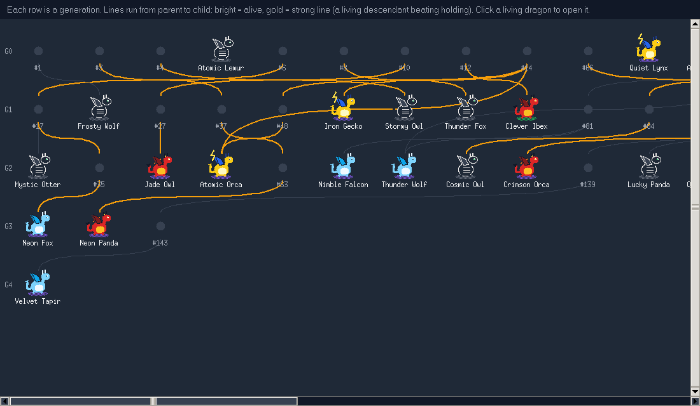
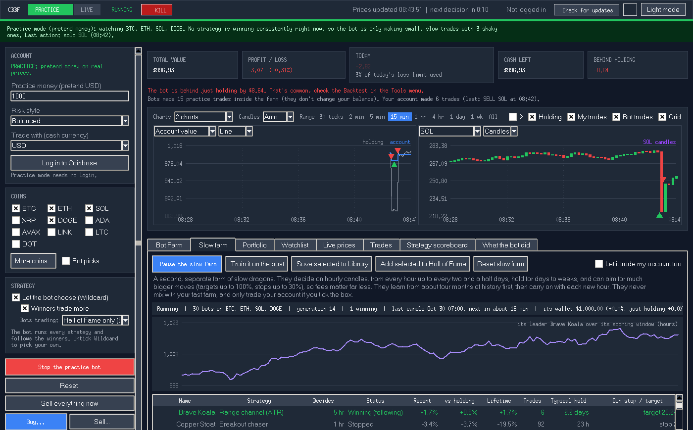
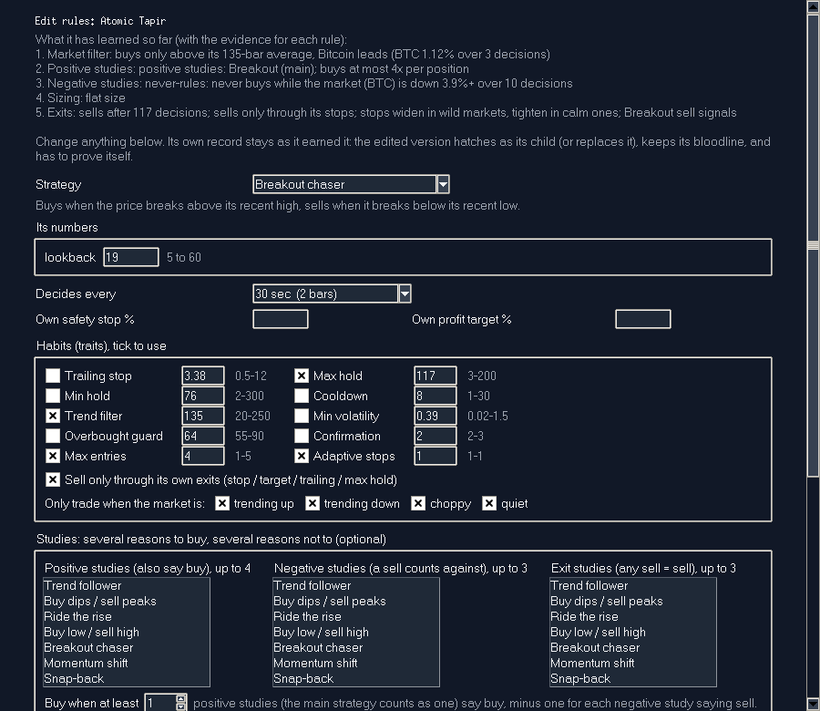
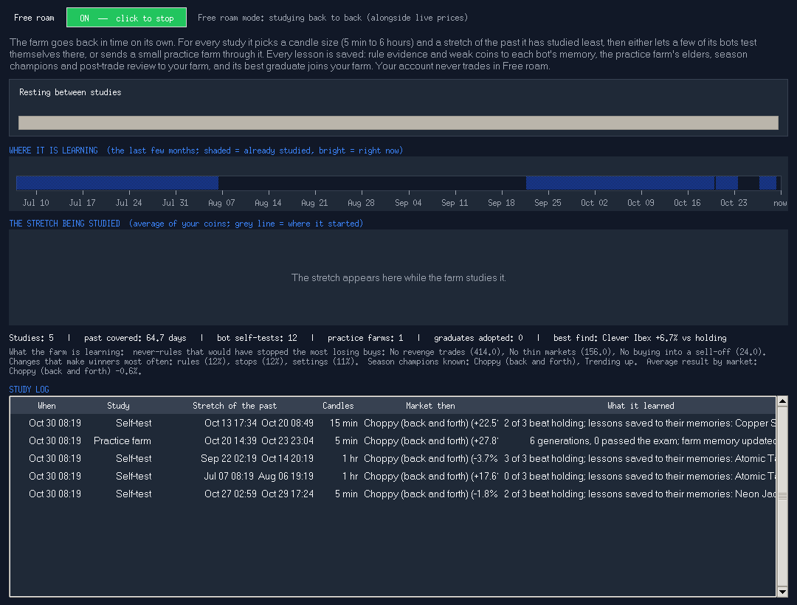
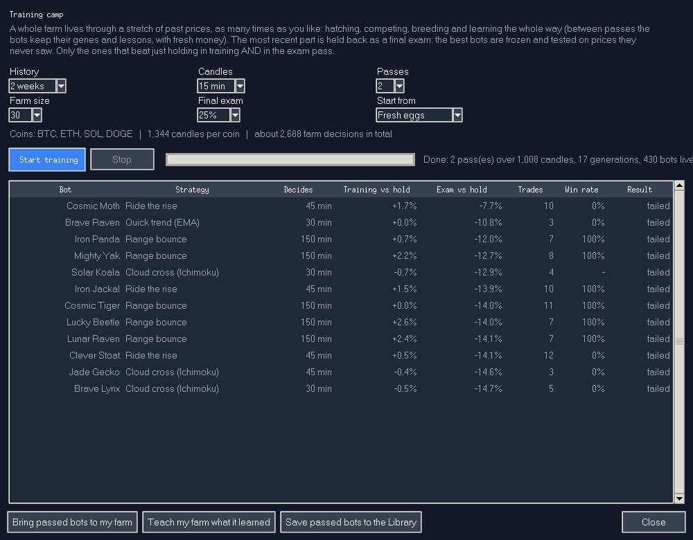
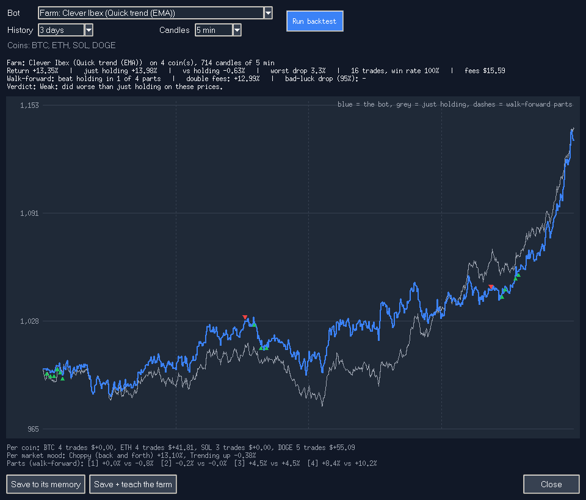
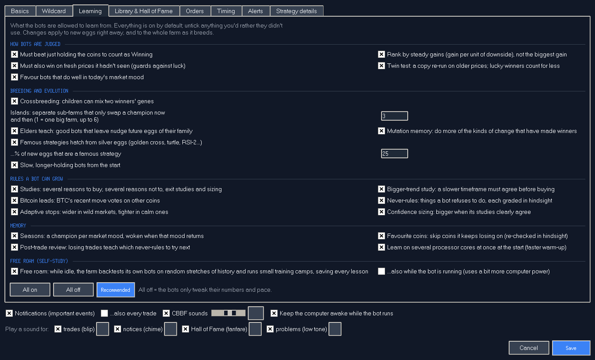
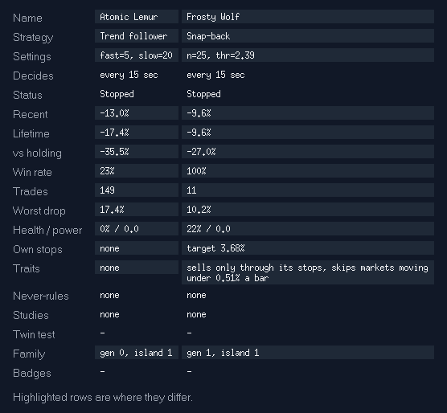
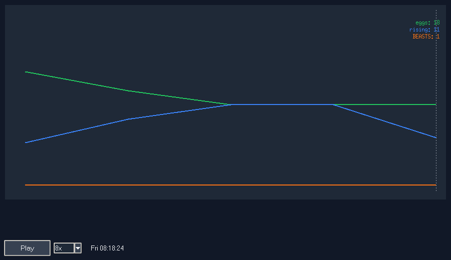

<b>Hatch a farm of little dragons. Let them compete, breed and evolve. Keep the legends.</b>

## Getting started
- **Windows:** download the latest release zip, extract the whole folder, double-click **Run CBBF.bat**
- **Mac / Linux:** `python3 main.py` (Python 3.8 or newer with Tkinter)

New versions appear inside the app as an **Update** button. Nothing installs until you say yes, and
**Tools > Undo last update** always takes you back.

---

## From egg to legend
Every dragon climbs the same ladder, and the farm sorts them into four dens, each with its own colour:

| Den | Who lives there |
|---|---|
| **Eggs** | Newborns still hatching and learning the ropes |
| **Rising** | Young dragons starting to prove themselves |
| **BEASTS** | The dominant ones, winning again and again |
| **Hall of Fame** | Your hand-picked champions. Only you decide who gets in |

Eggs crack open when they hatch and new BEASTS let out a roar. Every dragon has **XP, health and power**, and earns
**badges** along the way (First 10%, Crash survivor, Sharpshooter, Marathon, Dynasty, Twin-proven...).
A pulse strip above the farm shows births, retirements, the current season and the dragon of the hour.

## Breeding
- **Eggs from winners**: the strongest dragons lay eggs, copies of themselves with small mutations.
- **Crossbreeding**: two parents produce a child that mixes both sets of genes. Pair your favourites yourself.
- **Royal, silver and coloured eggs**: royal eggs carry your bloodlines, silver eggs are famous breeds from history.
- **Islands**: the farm splits into islands that breed apart and only swap a champion now and then, so the
  gene pool stays varied.
- **Elders**: great dragons that leave pass their wisdom on to future eggs.
- **Seasons**: every season has a champion, and it wakes up again when its season returns.
- **Mutation memory**: the farm notices which kinds of change make winners, and makes more of them.
- **Natural selection**: dragons that keep failing rest, then retire to make room.

## The Slow farm
A second farm of slow dragons lives next door. They think in hours and days instead of minutes, rest for days or
weeks at a time, and aim for much bigger moments. They learn from months of the past before they join in, keep
their own wallet, and never mix with the fast farm.

## A dragon's genes
Every gene is inherited, mutated and crossbred, and every dragon carries a different mix:

- **A main instinct**: more than twenty breeds, from patient trend riders to pouncers and breakout jumpers
- **Positive studies**: extra signals that vote *for* acting. **Negative studies**: signals that vote *against*
- **A bigger-picture study** that has to agree first, and an optional **follow-the-leader** study
- **Never-rules**: things it refuses to do, each one graded in hindsight; useful rules spread, costly ones fade
- **Pace**, **patience**, **exits** that adapt to calm or wild times, **confidence** that scales how boldly it acts
- **Memory**: what it's bad at, which seasons suit it, and every lesson from its tests

Each layer is graded on its own, and children inherit the evidence.

## See and edit what they learned
Open any dragon's rules with the evidence behind each one, change whatever you like, and hatch your edit as its
child. Or design an egg from scratch.

## Learning from the past
- **Free roam**: switch it on and the farm goes back in time by itself. It chooses its own stretches of the past
  and its own pace, lets its dragons test themselves, sends small practice farms through, and saves every lesson.
  A live screen shows where in the past it is right now, what it has covered, and what it has found.
- **Training camp**: send a whole farm through days or months of history, several times over, then give the best a
  final exam on a stretch they never saw. Graduates can join your farm or your Library.
- **Trials**: put any single dragon through a stretch of history, with a check of every part of it, a bad-luck
  test and a tougher-conditions test. Save the lesson to its memory, or teach the whole farm.
- **Bot Lab**: train on one stretch, test on the next.

## Choose what they learn
The **Learning** page switches each kind of learning on or off, grouped into how dragons are judged, how they
breed, which rules they can grow, what they remember, and free roam.

## Collect them all
Press **Catch!** on any dragon to keep it in your **Library**, or drag it straight onto the Library or
Hall of Fame tab.

- Every caught dragon gets a name, a rarity from **Common** to **Legendary**, and the occasional one is **shiny**
- Champions are re-checked every night; the ones losing their edge turn **rusty**
- Build a **team of up to 6**, compare two dragons side by side, export the farm or your favourites to a
  readable file, and import other people's dragons to see if they survive
- **Undo** is always one click away

## The farm never forgets
Close the app and come back later: the farm picks up exactly where it left off. Watch a **farm replay** of how the
dens grew, and get a **weekly report** of what it learned.

## Make it yours
- Dragons, simple cards or a plain list; full, light or no animation; a compact layout
- Dark and light themes, custom sounds, keyboard shortcuts, a short guided tour
- Farm presets (Calm, Balanced, Wild), settings profiles, one-click backup and restore
- Farm size up to 200, learning spread over several processor cores, and it goes quiet when minimised

## More screens

## Your data
Everything stays on your computer in `~/.cbbf/` (Windows: `C:\Users\<you>\.cbbf`). **File > Open data folder** opens it.

---

Past results never guarantee future ones, even for a Legendary dragon. Use at your own risk.
