
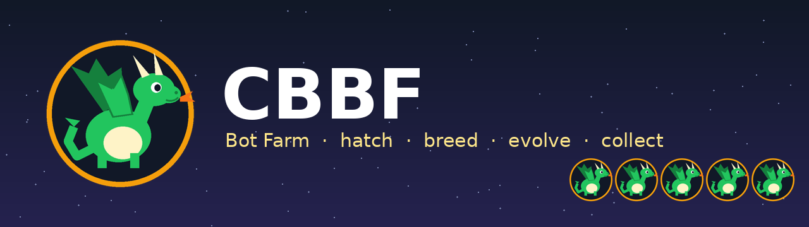

<b>Hatch a farm of trading bots. Train them, breed them, test them. Only the proven ones get a say.</b>

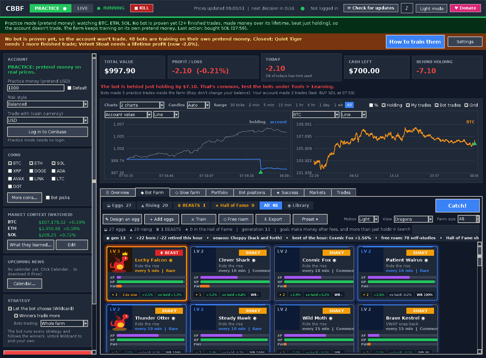

## Getting started
- **Windows:** download the latest release zip, extract the whole folder, double-click **Run CBBF.bat** (or **CBBF.pyw**)
- **Mac / Linux:** `python3 main.py` (Python 3.8 or newer with Tkinter)
- Start in **Practice**: pretend money on real prices. Nothing real is at risk until you choose otherwise.

New versions appear inside the app as an **Update** button. Nothing installs until you say yes, and
**Tools > Undo last update** always takes you back.

---

## A farm that trains itself
CBBF isn't one trading bot. It's a farm of them, each one a little dragon with its own genes: an instinct, a set of
rules, a sense of timing, its own stops and its own memory. They all trade on pretend money, side by side, on the same
prices. The good ones breed, the bad ones retire, and every generation starts from what the last one learned.

You don't have to write a strategy. You decide how much the farm is allowed to learn, and it does the rest.

## From egg to legend
Every dragon climbs the same ladder, and the farm sorts them into dens:

| Den | Who lives there |
|---|---|
| **Eggs** | Newborns still hatching and learning the ropes |
| **Rising** | Young dragons starting to prove themselves |
| **BEASTS** | The dominant ones, winning again and again |
| **Hall of Fame** | Your hand-picked champions. Only you decide who gets in |

Every dragon has **XP, health and power**, earns **badges**, and has a rarity from **Common** to **Legendary**. A pulse
strip above the farm shows births, retirements, the current season and the dragon of the hour.

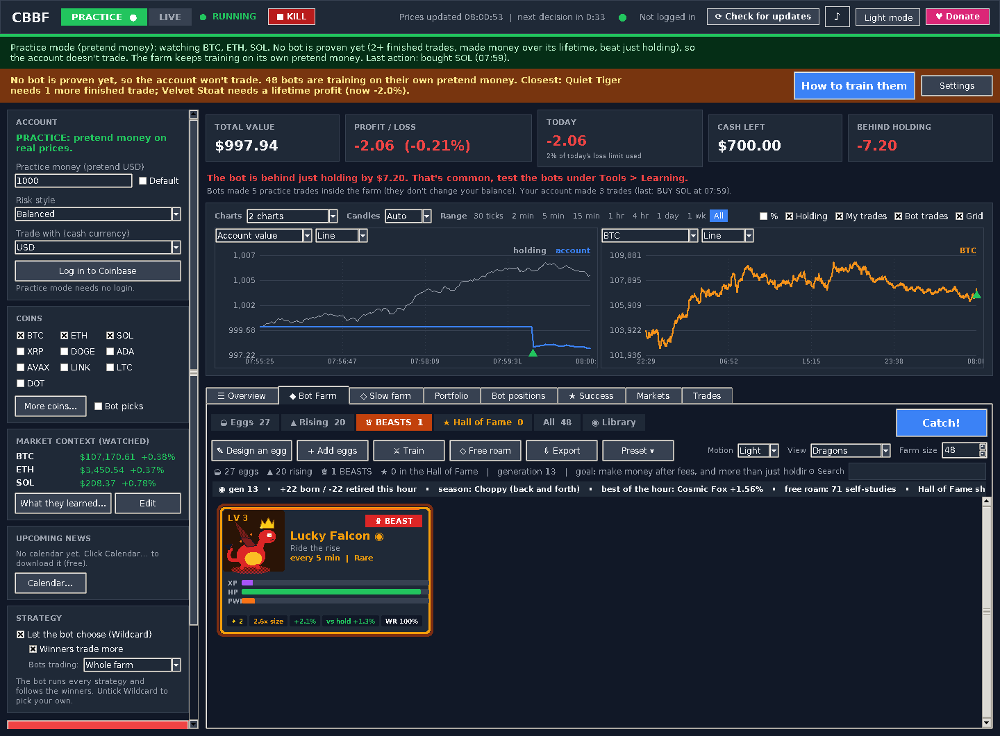

## Only proven bots get a vote
Being on the farm isn't enough to touch your account. A dragon only gets a say once it has a **real track record**:

- enough **finished trades** to judge it on
- at least one full scoring window on the farm
- money made over its **whole life**, and more than doing nothing would have made
- **passed exams** on days it never trained on

Among the proven ones, the best lifetime records get the **biggest say**. A dragon whose record slips loses its vote
again. Everything else keeps training on its own pretend money until it earns its place. The Overview shows how many
dragons have a vote right now, and who's leading.

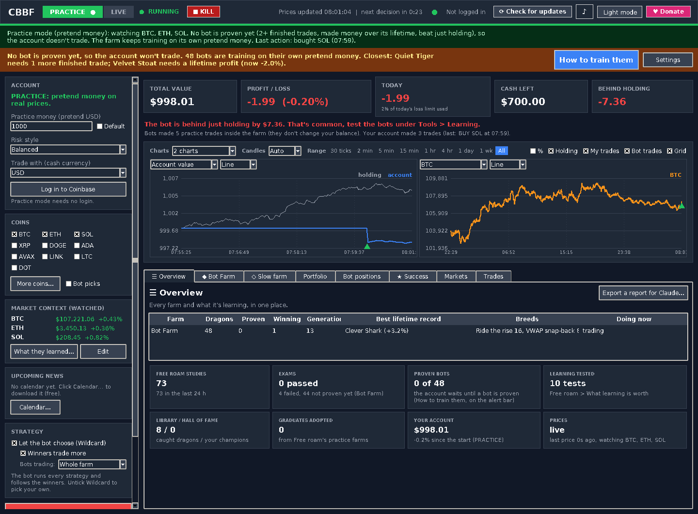

## What a dragon is made of
Every gene is inherited, mutated and crossbred, and every dragon carries a different mix:

- **An instinct**: more than twenty breeds, from patient trend riders to dip buyers, pouncers and breakout jumpers
- **Studies** that vote for or against acting, and a **bigger-picture** study that has to agree first
- **Market context**: studies on things it watches but never trades, like a fear gauge or the market leader
- **Never-rules**: things it refuses to do (no new trades before big news, none in the first minutes of the day...),
  each one graded in hindsight; useful rules spread, costly ones fade
- **Pace, patience, stops and targets**, exits that adapt to calm or wild times, and **confidence** that scales how
  boldly it acts
- **Memory**: what it's bad at, which seasons suit it, and every lesson from its tests

Each layer is graded on its own, and children inherit the evidence. Open any dragon's card to see its rules with the
evidence behind each one, change whatever you like, and hatch your edit as its child. Or design an egg from scratch.

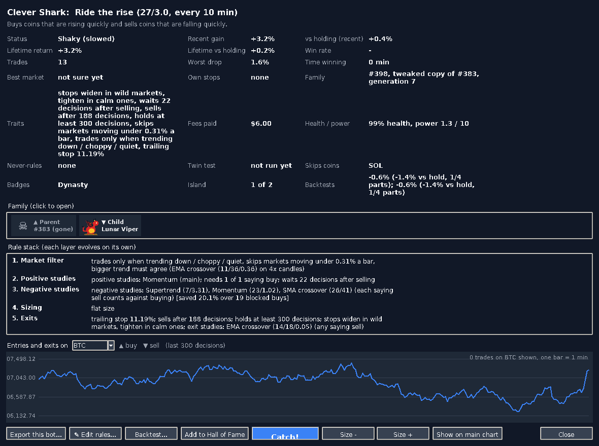

## How they breed
- **Eggs from winners**: the strongest dragons lay eggs, copies of themselves with small mutations
- **Crossbreeding**: two parents produce a child that mixes both sets of genes. Pair your favourites yourself
- **Royal and silver eggs**: royal eggs carry your bloodlines, silver eggs hatch famous strategies from history
- **Islands**: the farm splits into islands that breed apart and only swap a champion now and then
- **Elders**: great dragons that leave pass their wisdom on to future eggs
- **Seasons**: every kind of market has a champion, and it wakes up again when that season returns
- **Mutation memory**: the farm notices which kinds of change make winners, and makes more of them
- **Natural selection**: dragons that keep failing rest, then retire to make room

## The breeds
- **Long-term dragons** ride trends and dips over minutes to days.
- **The slow farm** is a second farm next door: patient dragons that think in hours and days, with their own wallet.

## Training
- **Free roam**: switch it on and the farm wanders off through history by itself. It picks its own stretches and pace,
  sends dragons on trials and small practice farms, and brings every lesson home. A live screen shows where it is and what it found.
- **Training camp**: send a whole farm through a long stretch several times over, then give the best a final exam on
  ground they've never seen. Graduates can join your farm or your Library.
- **Trials and backtests**: put any single dragon to the test, with a bad-luck test and a tougher-conditions test.
- **Exams**: one day in five is held back. Dragons are examined on days they never trained on, and only the ones that
  clearly beat luck can rise to the top.
- **What learning is worth**: the farm tests its own learning switches (same dragons, same luck, one switch on, then
  off) and tells you which ones really help.

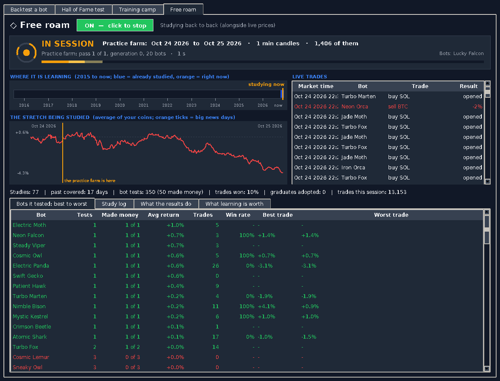

## Family and bloodlines
Every dragon remembers its parents. The **family tree** and **bloodlines** show which families keep producing winners,
which kinds of change made the difference, and which lines died out.

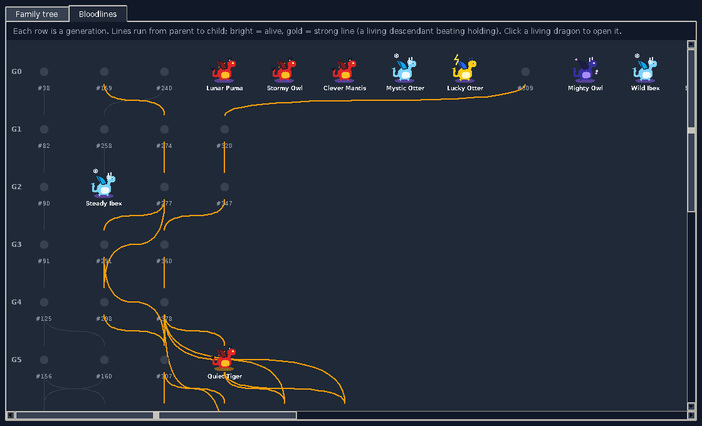

## Collect them all
Press **Catch!** on any dragon to keep it in your **Library**, or drag it straight onto the Library or Hall of Fame.

- Every caught dragon gets a name, a rarity, and the occasional one is **shiny**
- Champions are re-checked every night; the ones losing their edge turn **rusty**
- Build a **team of up to 6**, compare two dragons side by side, export your favourites, and import other people's
  dragons (from SBF, OBF too) to see if they survive on your farm

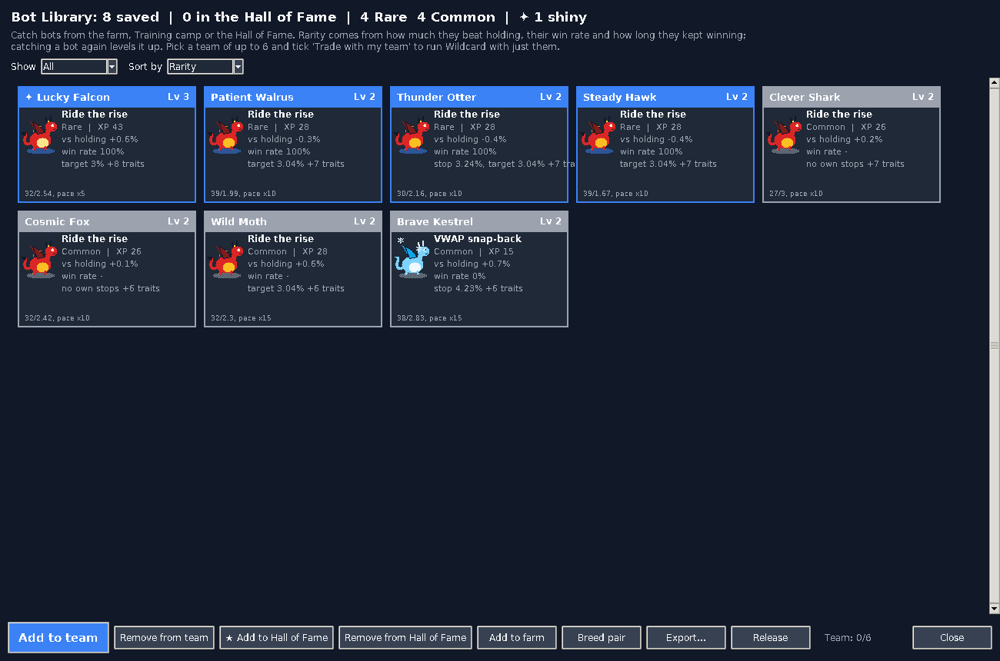

## Watch it work
The **Portfolio** shows what your account holds and why, **Bot positions** shows what every dragon is holding with its
own pretend money, and **Success** charts who's been winning over time.

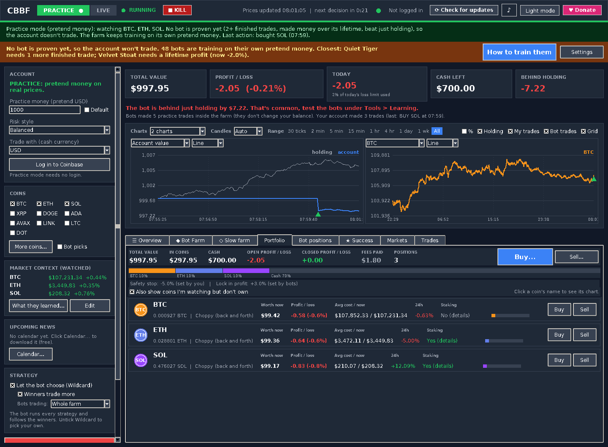

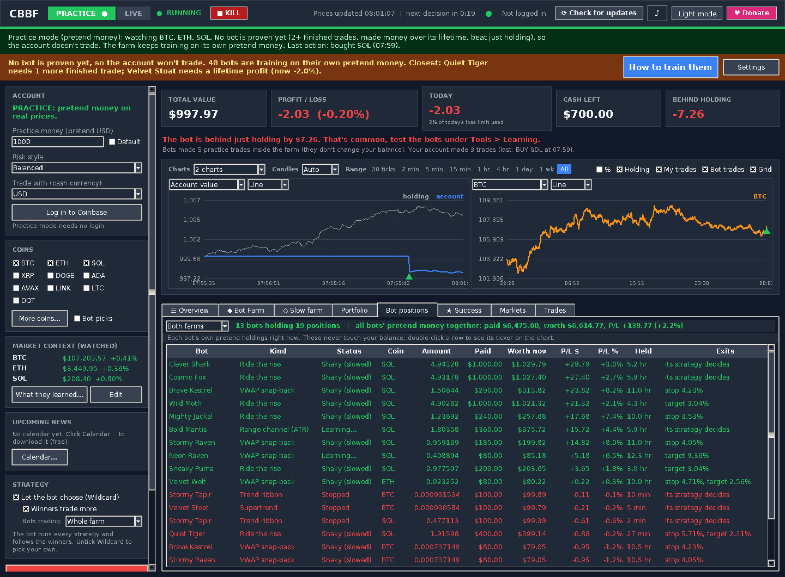

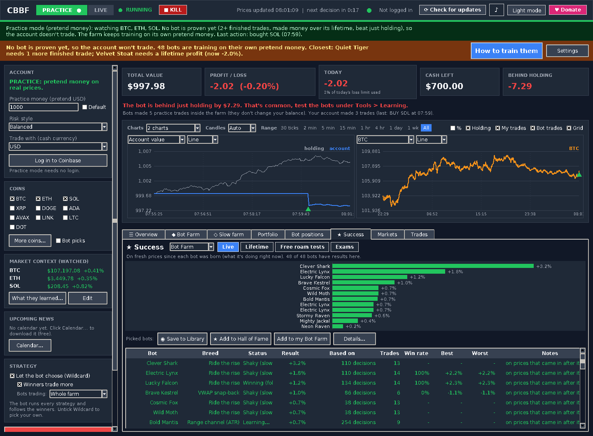

## Safety built in
- **Practice first**: pretend money on real prices, with fees and spreads counted
- A safety stop, lock-in profit, trailing stop, daily loss limit and a limit per position
- It only ever sells what it holds
- Real money needs you at the computer typing LIVE, and the **kill switch** (Account menu) stops everything,
  cancels waiting orders, sells everything and locks LIVE

## The farm never forgets
Close the app and come back later: the farm picks up exactly where it left off. Watch a **farm replay** of how the
dens grew, and get a **weekly report** of what it learned.

## Make it yours
- Dragons, simple cards or a plain list; full, light or no animation; a compact layout
- Dark (shown here) and light themes, custom sounds, keyboard shortcuts, a short guided tour
- Farm presets, settings profiles, one-click backup and restore
- Farm size up to 200, learning spread over several processor cores, and it goes quiet when minimised

## Your data
Everything stays on your computer in `~/.cbbf/` (Windows: `C:\Users\<you>\.cbbf`). **File > Open data folder**
opens it. Keys are kept in your system keychain, never in CBBF's files.

## Support the farm
CBBF is free and made in spare time. If you'd like to help the farm grow, press **Donate** in the top right of the app,
or support it on **[GitHub Sponsors](https://github.com/sponsors/kefirman9000)**: every bit goes into new breeds, new
tricks and more time to build them. Starring the repo and sharing your best dragons helps too.

## License and disclaimer
Copyright © 2026 kefirman9000. All rights reserved. CBBF is free to use; see [LICENSE](LICENSE) for what is and isn't
allowed.

- **Not financial advice.** CBBF is a learning and experimentation tool. Nothing it shows is advice or a
  recommendation.
- You can lose money. You alone are responsible for every action taken through your account. Always practise first
  and never use money you can't afford to lose.
- Software can have bugs, connections can fail, and data can be late or wrong. Check your account directly.

CBBF is provided **as is**, without warranty of any kind. Found a security problem? Please report it privately; see
[SECURITY.md](SECURITY.md).

Past results never guarantee future ones, even for a Legendary dragon.
