
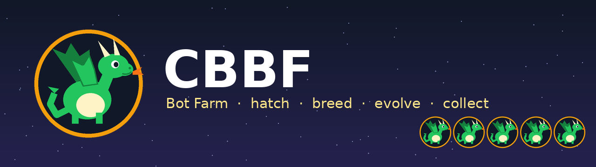

# CBBF — Bot Farm

Hatch a farm of little dragon bots and let nature take its course. They grow up, compete, mate, pass their
genes to the next generation and slowly evolve into BEASTS. The best ones you keep forever.

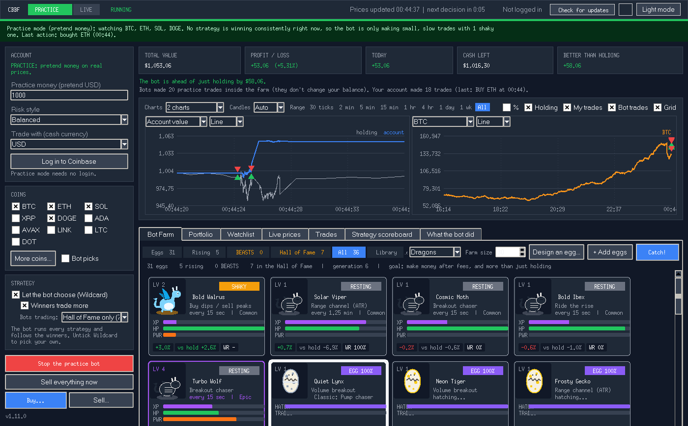

## Getting started
- **Windows:** download the latest release zip (or Code > Download ZIP), extract the whole folder, double-click **Run CBBF.bat**
- **Mac / Linux:** `python3 main.py` (Python 3.8 or newer with Tkinter)

New versions show up inside the app as an **Update** button. Nothing installs until you say yes, and
**Tools > Undo last update** always takes you back.

---

## From egg to legend
Every dragon climbs the same ladder, and the farm sorts them into four dens:

| Den | Who lives there |
|---|---|
| **Eggs** | Newborns still hatching and learning the ropes |
| **Rising** | Young dragons that have started to prove themselves |
| **BEASTS** | The dominant ones, winning again and again |
| **Hall of Fame** | Your hand-picked champions. Only you decide who gets in |

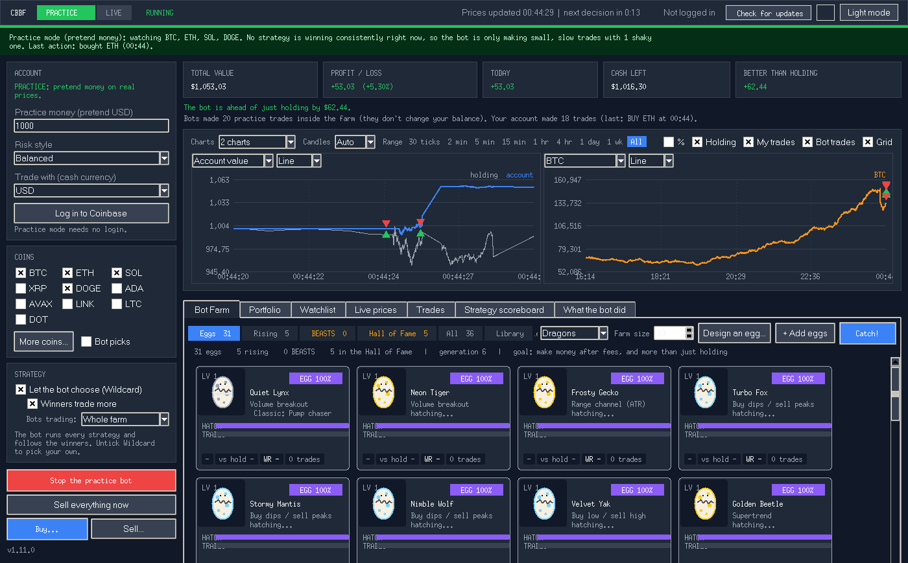

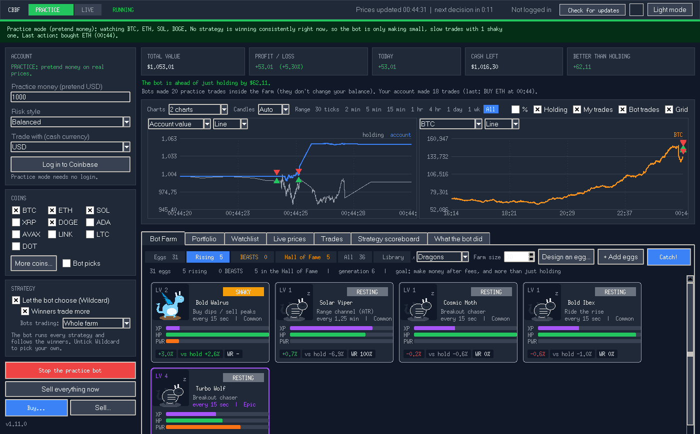

Each dragon has **XP, health and power**. Health drops when it stumbles and recovers when it does well.
Power only grows from real, lasting wins, so a dragon with a full power bar has truly earned it. Working
dragons flap and look around, resting ones curl up and snooze, and the elemental look (fire, ice,
lightning, space, skeleton) tells you its family at a glance.

## Breeding
This is the heart of the farm.

- **Eggs from winners.** The strongest dragons lay eggs: copies of themselves with small mutations.
- **Crossbreeding.** Two parents produce a child that mixes genes from both. Drag your favourites from the
  Library or Hall of Fame onto the farm and pair them yourself with **Breed pair**.
- **Royal eggs.** Children of your hand-picked bloodlines hatch from **gold eggs**, so you can follow your line.
- **Silver eggs.** Every so often the farm drops in a famous, time-tested (or infamous) breed to see whether it
  can hold its own against the youngsters.
- **Colored eggs.** Optional egg colors, so a full nest isn't all the same.
- **Fresh blood.** Brand-new random dragons keep the gene pool from going stale.
- **Natural selection.** Dragons that keep failing rest, then retire to make room for the next generation.
- **Adaptive evolution.** When the farm gets stuck, mutations get bolder; when it's thriving, they get careful.

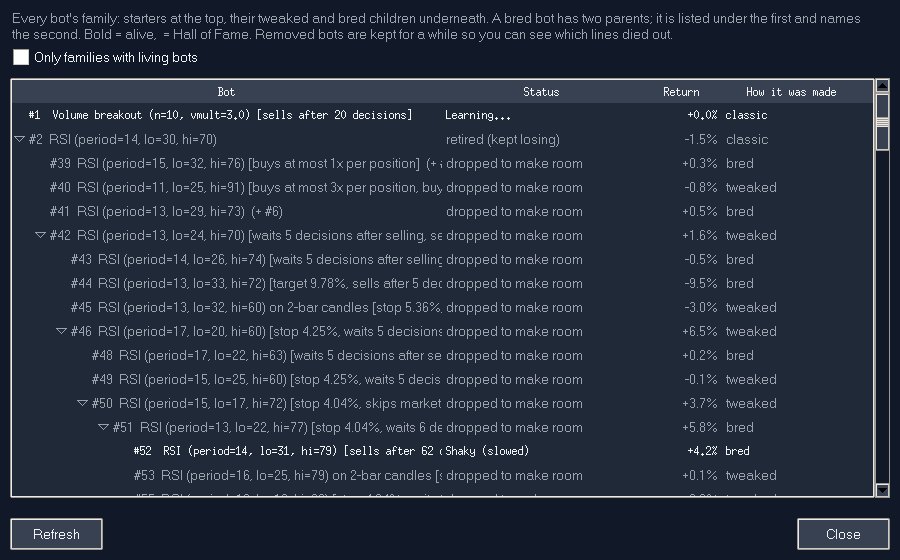

**Family tree:** see every dragon's ancestry, which bloodlines thrived and which died out.

## What's in a dragon's genes
Every gene is inherited, mutated and crossbred, and every dragon carries a different mix:

- **A main instinct.** More than twenty breeds, from patient trend riders to dip pouncers and breakout jumpers.
- **Positive studies.** Zero to four extra signals that vote *for* acting. Some dragons trust one instinct,
  others wait until several agree.
- **Negative studies.** Zero to three signals that vote *against*. A dragon can learn when to hold back.
- **Exit studies.** Their own reasons to let go.
- **Never-rules.** Hard "I will never do this" habits, each tested in hindsight: if a never-rule keeps
  costing the dragon, it fades out of the bloodline. If it keeps saving it, it spreads.
- **How many votes it needs.** Cautious dragons need many studies to agree; bold ones act on one.
- **Pace.** From every few seconds to every few hours.
- **Traits.** Patience, cooldowns, how long to hold, its own safety and target, sizing by confidence, and more.

Each layer is graded on its own, so the farm learns which studies and rules actually help, and the children
inherit what worked.

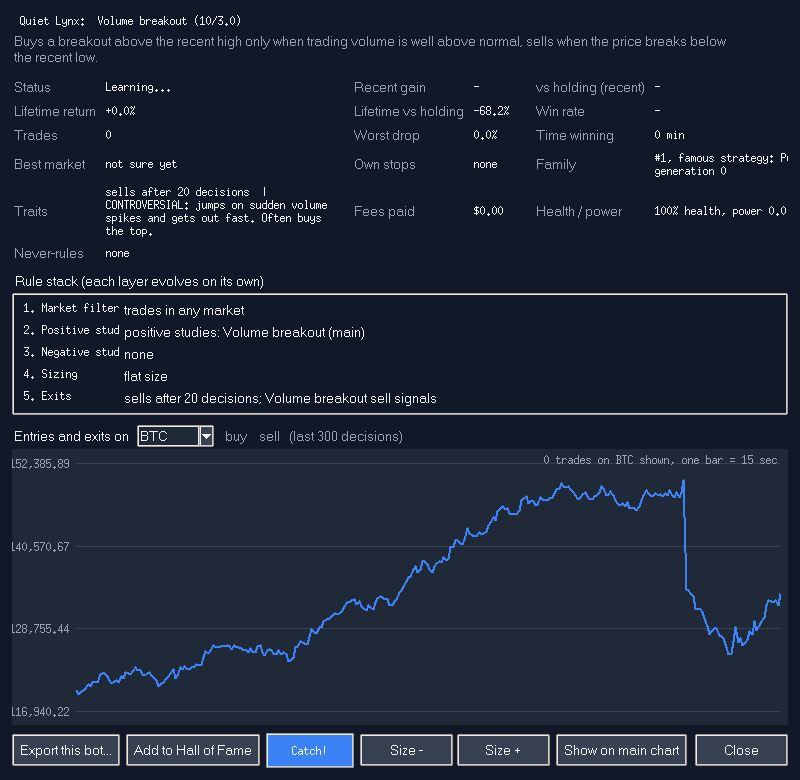

Double-click any dragon to see its card: its whole **rule stack**, health and power, family, and history.

## Design your own egg
Write a dragon from scratch: choose its instinct and numbers, its positive and negative studies, its exits
and its habits. It hatches as a royal egg, competes like everyone else, and its children carry your design.

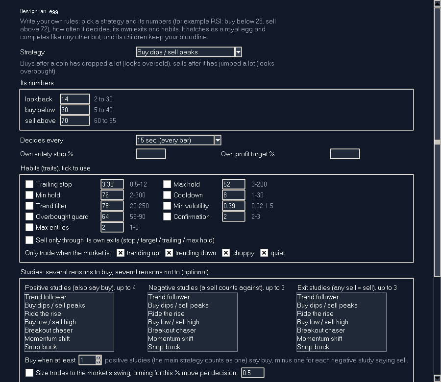

## Bot Lab
Raise a fresh farm on one stretch of history, freeze the best dragons, then send them into a later stretch
they have never seen. Only the ones that still win there **pass**. Run several rounds to tell real talent from luck.

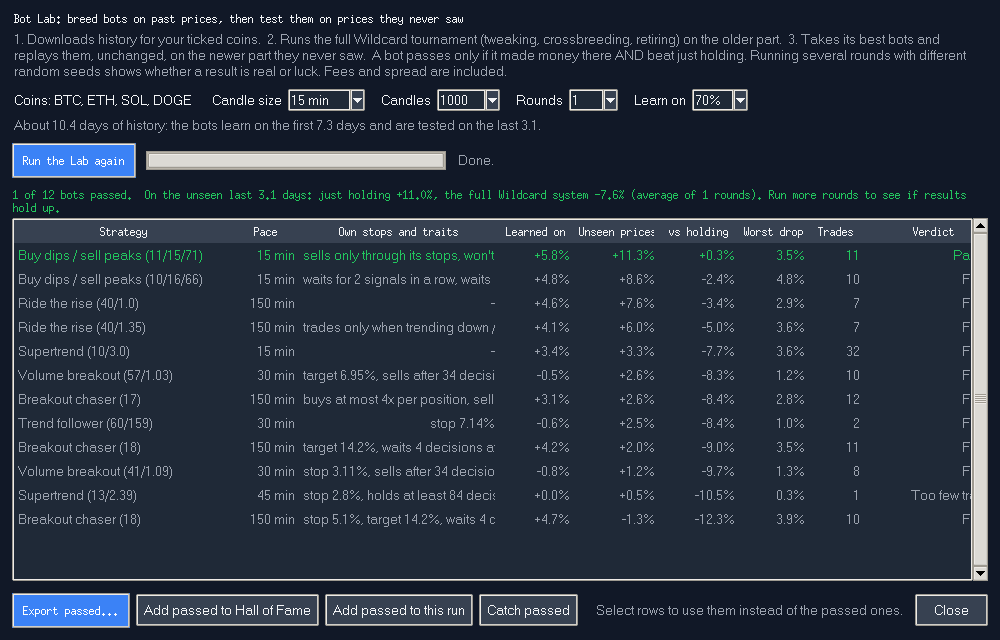

## Collect them all
Press **Catch!** on any dragon to keep it in your **Library**.

- Every caught dragon gets a name, like Silent Bison or Turbo Wolf.
- Rarity from **Common** to **Legendary**, earned by what it has really done. The occasional one is **shiny**.
- Catch it again as it keeps proving itself and it levels up.
- Promote favourites to the **Hall of Fame**, build a **team of up to 6**, and run the farm with only them.
- Right-click anything for quick actions.
- **Export** the whole farm, a den, or just your picks to a readable file that people, other apps or an AI can
  understand, and import other people's dragons to see if they survive on your farm.

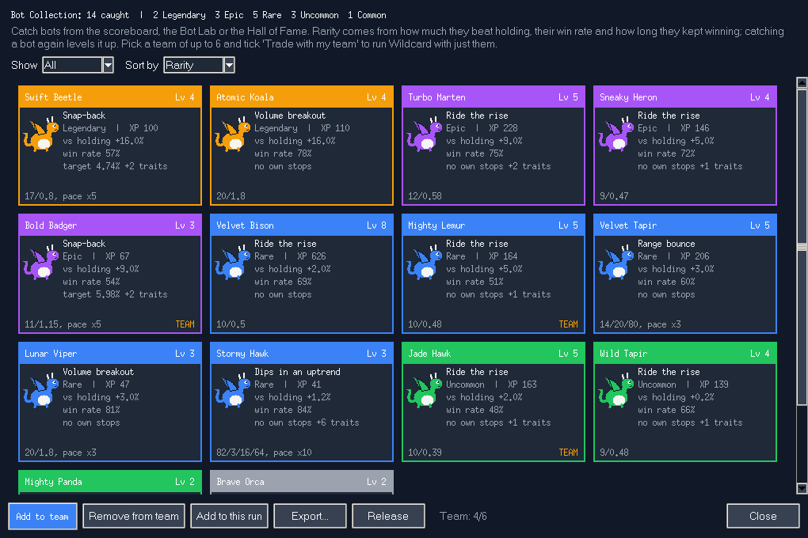

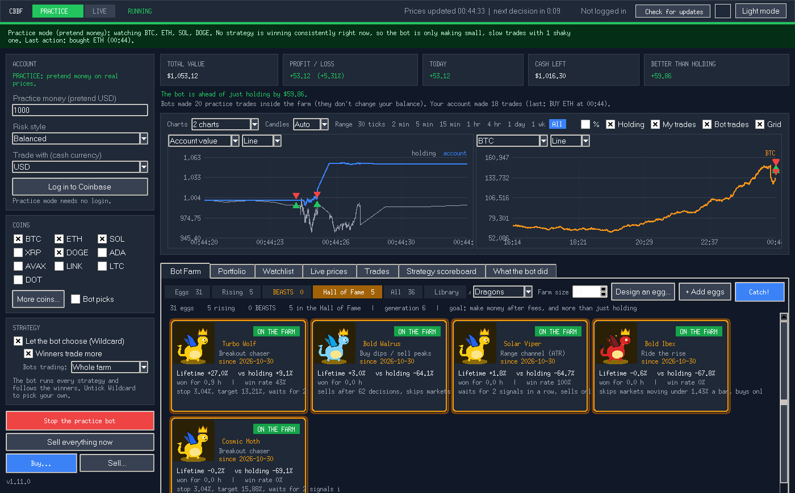

## The farm never forgets
Close the app and come back later: the farm picks up exactly where it left off, with every dragon, egg,
family line and lesson intact.

## Make it yours
- Dragons, simple cards or a plain list
- Full, light or no animation, so even hundreds of dragons stay smooth
- Dark and light themes, custom sounds (each one can be switched off), keyboard shortcuts
- Farm size up to 200, and **+ Add eggs** whenever you want more

## More screens

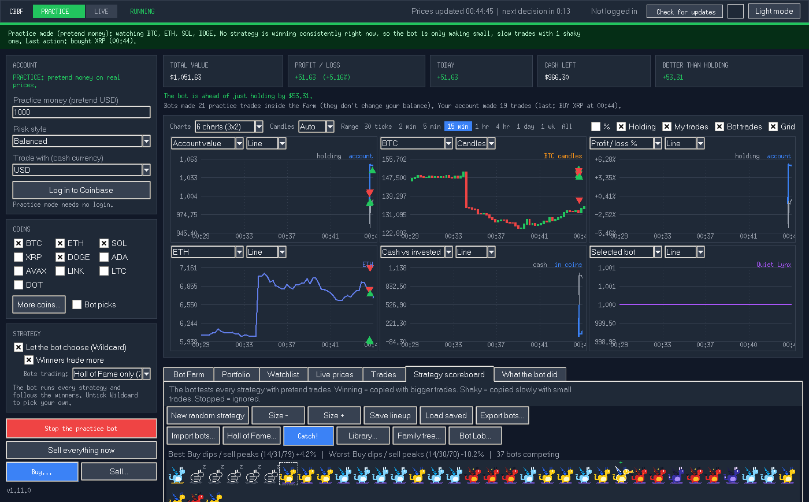

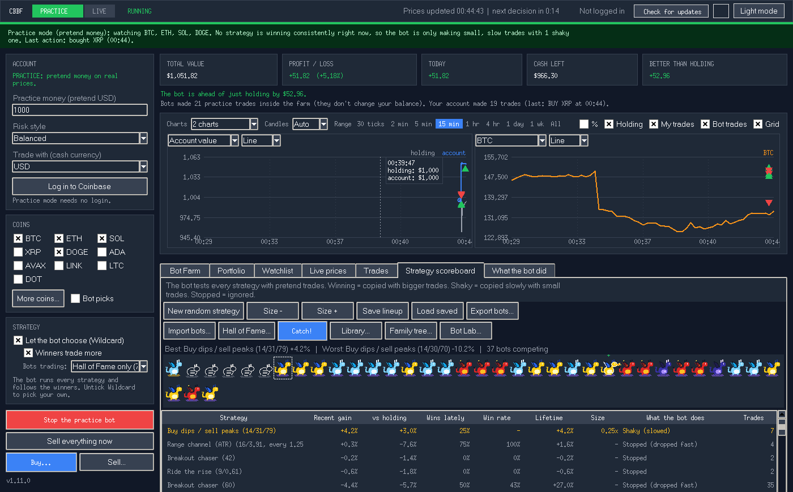

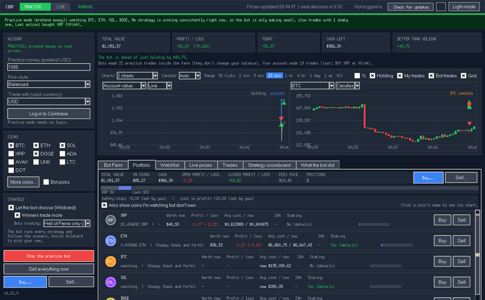

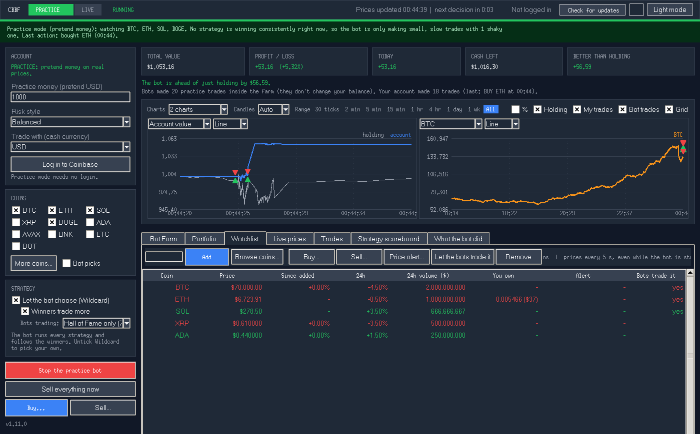

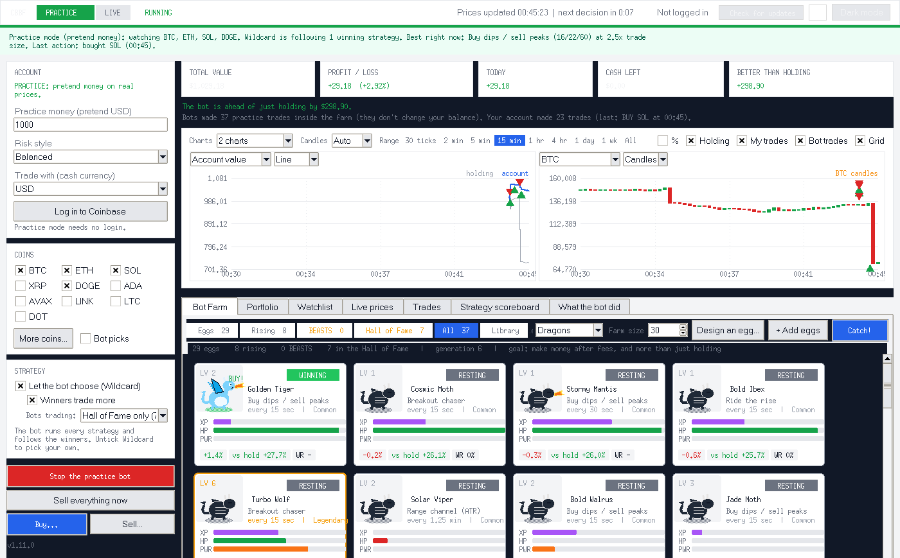

## Your data
Everything stays on your computer in `~/.cbbf/` (Windows: `C:\Users\<you>\.cbbf`): settings, saved farms,
Library, Hall of Fame and logs. **File > Open data folder** opens it.

---

Past results never guarantee future ones, even for a Legendary dragon. Use at your own risk.
